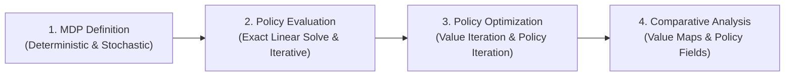
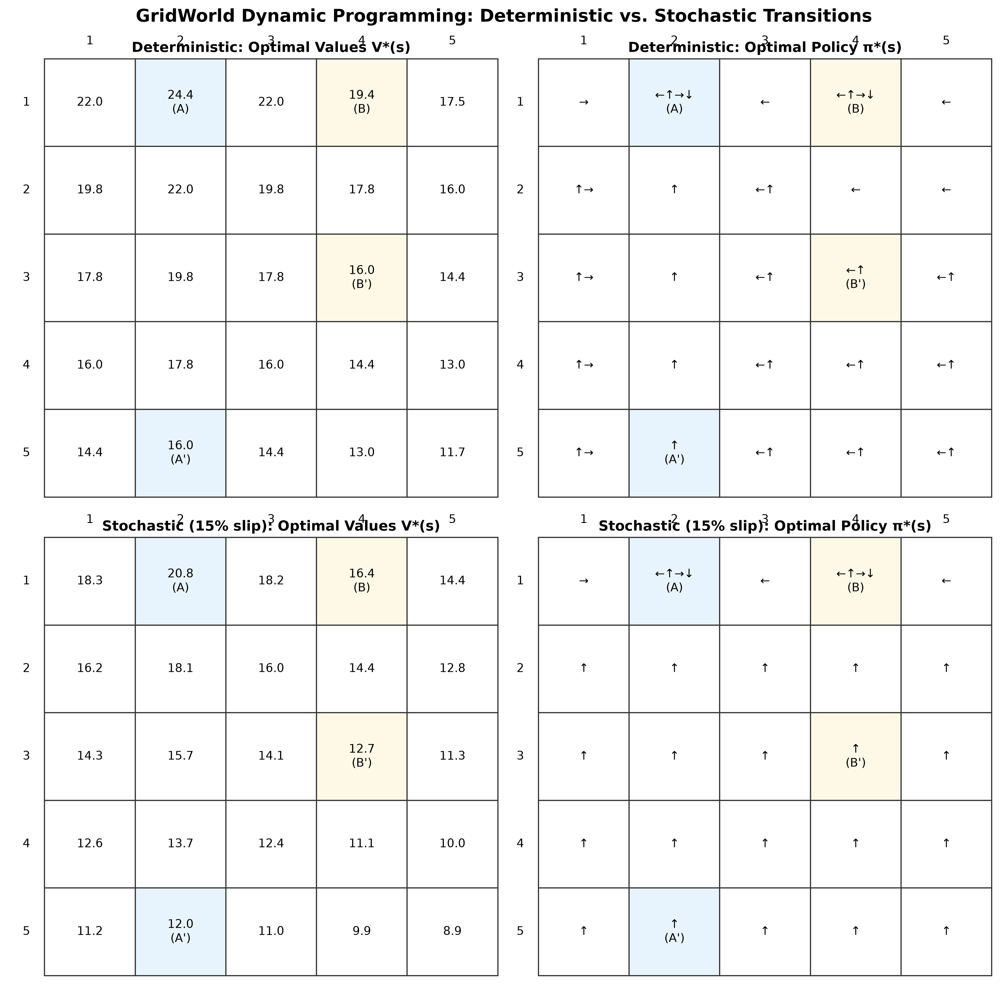

# GridWorld MDP & Dynamic Programming Suite

[](https://www.python.org/)
[](LICENSE)
[](https://numpy.org/)
[](https://matplotlib.org/)

An exact and iterative **Dynamic Programming** suite solving Markov Decision Processes (MDPs) on a 5×5 Gridworld under both **deterministic** and **stochastic** transition dynamics, based on Example 3.5 from Sutton & Barto (*Reinforcement Learning: An Introduction*, 2018).

---

## 🎯 The Problem Statement

### 1. The Scenario
Consider an agent navigating a discrete $5 \times 5$ grid of cells (25 states). At each step, the agent can attempt to move in one of four cardinal directions: **Left ($\leftarrow$)**, **Up ($\uparrow$)**, **Right ($\rightarrow$)**, or **Down ($\downarrow$)**.

```text
       Col 1        Col 2        Col 3        Col 4        Col 5
Row 1 [  .  ]     [  A   ]     [  .  ]     [  B   ]     [  .  ]   <-- Jump: A (+10), B (+5)
Row 2 [  .  ]     [  .   ]     [  .  ]     [  .   ]     [  .  ]
Row 3 [  .  ]     [  .   ]     [  .  ]     [  B'  ]     [  .  ]   <-- B lands at B' (Row 3, Col 4)
Row 4 [  .  ]     [  .   ]     [  .  ]     [  .   ]     [  .  ]
Row 5 [  .  ]     [  A'  ]     [  .  ]     [  .   ]     [  .  ]   <-- A lands at A' (Row 5, Col 2)
      ════════════ Any move off the outer boundary gives -1 penalty ════════════
```

The environment has the following governing rules and reward structure:
* **Special "Wormhole" Jumps**:
  * **State $A$ at $(0, 1)$**: Any action taken from state $A$ teleports the agent to $A'$ at $(4, 1)$ and yields a large positive reward of **$+10.0$**.
  * **State $B$ at $(0, 3)$**: Any action taken from state $B$ teleports the agent to $B'$ at $(2, 3)$ and yields a reward of **$+5.0$**.
* **Boundary Collisions**: Attempting to move off the grid bounces the agent back to its current cell and incurs a penalty of **$-1.0$**.
* **Standard Transitions**: Any ordinary move within the grid yields an immediate reward of **$0.0$**.
* **Discount Factor**: Future rewards are discounted by $\gamma = 0.9$, meaning immediate rewards are valued more than distant future rewards.

### 2. Transition Dynamics: Deterministic vs. Stochastic Slip
Real-world systems rarely execute commands with 100% precision. To study the effect of environmental uncertainty, we formulate two distinct transition models:

1. **Deterministic Dynamics**: Actions always succeed with probability $1.0$.
2. **Stochastic Dynamics (Action Slipping)**:
   * The intended action succeeds with probability **$0.85$** (85% fidelity).
   * The agent accidentally slips into each of the other three directions with probability **$0.05$** each (15% total slip probability).

### 3. Core Objectives
1. **Policy Evaluation**: How do we compute the exact long-term expected return (state-value function $V(s)$) for every cell when the agent moves completely at random (uniform equiprobable policy)?
2. **Optimal Control**: How do we find the optimal policy $\pi^*(s)$ that instructs the agent on the exact best action(s) to take from any cell to maximize cumulative discounted rewards?
3. **Exploration vs. Exploitation**: How does introducing $\epsilon$-greedy exploration ($\epsilon \in \{0.0, 0.2\}$) affect policy convergence and value functions?
4. **Impact of Uncertainty**: How does stochastic action slip alter the value landscape and reshape optimal decision-making near dangerous boundaries?

---

## 💡 How We Solve It: Dynamic Programming Methodology

We solve this finite Markov Decision Process $(\mathcal{S}, \mathcal{A}, \mathcal{P}, \mathcal{R}, \gamma)$ using model-based Dynamic Programming through a four-part roadmap:



### Step 1: Environment & Transition Modeling
We formalize state transitions as conditional probability distributions $P(s' \mid s, a)$ and expected immediate rewards $R(s, a)$. The environment is implemented as a modular class `GridWorldEnv` that handles boundary bounces, jump states, and stochastic slipping kernels.

### Step 2: Policy Evaluation (Prediction)
To compute $V^\pi(s)$ under a given policy $\pi$, we implement two complementary approaches:
* **Exact Linear Matrix Solver**: Because the state space is discrete ($N = 25$ states), the Bellman expectation equation forms a closed-form system of linear equations:
  $$(I - \gamma P_\pi) V = R_\pi \implies (\gamma P_\pi - I) V = -R_\pi$$
  We solve this directly via matrix inversion (`np.linalg.solve`), yielding an exact analytical solution without convergence approximations.
* **Iterative Policy Evaluation**: We repeatedly apply the Bellman expectation backup operator until contraction convergence:
  $$V_{k+1}(s) \leftarrow \sum_{a} \pi(a \mid s) \left[ R(s, a) + \gamma \sum_{s'} P(s' \mid s, a) V_k(s') \right]$$
  This verifies that iterative dynamic programming converges to the identical analytical solution.

### Step 3: Optimal Control (Value Iteration & Policy Iteration)
To discover the optimal policy $\pi^*(s)$ and optimal value function $V^*(s)$:
* **Value Iteration**: Directly updates state values using the non-linear Bellman optimality operator:
  $$V_{k+1}(s) \leftarrow \max_{a} \left[ R(s, a) + \gamma \sum_{s'} P(s' \mid s, a) V_k(s') \right]$$
  Once values converge ($\max |V_{k+1} - V_k| < 10^{-4}$), the optimal greedy policy is derived.
* **Policy Iteration with $\epsilon$-Greedy Exploration**: Alternates between:
  1. *Policy Evaluation*: Computing the value function $V^\pi$ for the current policy.
  2. *Policy Improvement*: Extracting an $\epsilon$-greedy policy $\pi_\epsilon$ with multi-action tie-breaking:
     $$\pi_\epsilon(a \mid s) = \begin{cases} \frac{1 - \epsilon}{|A^*(s)|} + \frac{\epsilon}{|A|} & \text{if } a \in A^*(s) \\ \frac{\epsilon}{|A|} & \text{otherwise} \end{cases}$$
  Tested across $\epsilon = 0.0$ (pure exploitation) and $\epsilon = 0.2$ (20% stochastic exploration).

### Step 4: Comparative Analysis & Empirical Verification
We generate side-by-side directional vector fields and state-value heatmaps to evaluate the behavioral shift between deterministic and stochastic environments.

---

## 📸 Key Results & Behavioral Insights

Below is the master comparison of optimal state values $V^*(s)$ and optimal policies $\pi^*(s)$ across deterministic and stochastic environments:

<p align="center">
  
</p>

### Quantitative Findings

| State / Metric | Deterministic $V^*(s)$ | Stochastic $V^*(s)$ (15% slip) | Difference ($\Delta$) | Behavioral Implication |
| :--- | :---: | :---: | :---: | :--- |
| **State $A$ $(0, 1)$** | **$22.0$** | **$17.8$** | $-19.1\%$ | Value drops because after teleporting to $A'$, subsequent actions risk slipping into the bottom wall. |
| **State $B$ $(0, 3)$** | **$17.8$** | **$14.4$** | $-19.1\%$ | Value drops due to accumulated slip risks on trajectories toward $A$. |
| **Center State $(2, 2)$** | **$17.8$** | **$12.3$** | $-30.9\%$ | Central cell remains safe from immediate wall penalties, but future return drops due to global uncertainty. |
| **Corner State $(4, 4)$** | **$14.4$** | **$8.8$** | $-38.9\%$ | Worst affected: adjacent to two boundary walls on the right and bottom, carrying high double-wall slip penalty. |

### Key Behavioral Insight: Emergence of Risk Aversion
* **In the Deterministic World**: The agent happily walks directly along the perimeter edges (e.g. moving Left along Row 1 or Up along Col 1). Because movement is 100% reliable, being adjacent to a wall carries zero hazard.
* **In the Stochastic World**: The optimal policy shifts away from the borders. The agent learns **risk-averse trajectories**: it prefers pointing toward interior cells to maintain a "safety buffer" against accidental slips into the penalty walls.

---

## 🔬 Mathematical Formulations

### 1. Bellman Expectation Equation (Arbitrary Policy $\pi$)
$$V_\pi(s) = \sum_{a \in \mathcal{A}} \pi(a \mid s) \left[ R(s, a) + \gamma \sum_{s' \in \mathcal{S}} P(s' \mid s, a) V_\pi(s') \right]$$

### 2. Closed-Form Matrix Inversion
For a state space of size $N = |\mathcal{S}| = 25$:
* Transition matrix under policy $\pi$: $P_\pi \in \mathbb{R}^{25 \times 25}$, where $P_\pi(s, s') = \sum_a \pi(a \mid s) P(s' \mid s, a)$.
* Expected immediate reward vector: $R_\pi \in \mathbb{R}^{25}$, where $R_\pi(s) = \sum_a \pi(a \mid s) R(s, a)$.
* Exact value vector: $V_\pi = (I - \gamma P_\pi)^{-1} R_\pi$.

### 3. Bellman Optimality Equation
$$V^*(s) = \max_{a \in \mathcal{A}} \left[ R(s, a) + \gamma \sum_{s' \in \mathcal{S}} P(s' \mid s, a) V^*(s') \right]$$
$$\pi^*(s) = \arg\max_{a \in \mathcal{A}} \left[ R(s, a) + \gamma \sum_{s' \in \mathcal{S}} P(s' \mid s, a) V^*(s') \right]$$

---

## 📌 Attribution & Scope of Contributions

This project builds upon the foundational Gridworld environment from [Shangtong Zhang's Reinforcement Learning repository](https://github.com/ShangtongZhang/reinforcement-learning-an-introduction) (Chapter 3, Example 3.5 from *Reinforcement Learning: An Introduction* by Sutton & Barto).

### Base Framework ([Shangtong Zhang](https://github.com/ShangtongZhang) & [Kenta Shimada](https://github.com/hyperkentakun))
* Baseline 5×5 Gridworld layout, coordinates, and deterministic transition mechanics.
* Base Matplotlib table visualization boilerplate.
* Baseline implementations of uniform-random policy evaluation (Figure 3.2) and deterministic Value Iteration (Figure 3.5).

### Extensions & Algorithmic Contributions (Rishikesh)
* **Stochastic Transition Kernel**: Engineered stochastic environment dynamics where the intended action executes with probability $0.85$ and orthogonal/opposite actions each slip with probability $0.05$.
* **Generalized Linear System Policy Evaluation**: Extended the closed-form matrix solver $(I - \gamma P_\pi) V = R_\pi$ to evaluate **any arbitrary stochastic policy matrix $\pi(a \mid s)$**, generalizing beyond the uniform random policy.
* **$\epsilon$-Greedy Policy Engine**: Developed an $\epsilon$-greedy policy extraction module with automated multi-action tie breaking and exact probability redistribution:
  $$\pi_\epsilon(a \mid s) = \begin{cases} \frac{1 - \epsilon}{|A^*(s)|} + \frac{\epsilon}{|A|} & \text{if } a \in A^*(s) \\ \frac{\epsilon}{|A|} & \text{otherwise} \end{cases}$$
* **Policy Iteration Engine**: Implemented the complete Policy Iteration algorithm (alternating policy evaluation and policy improvement until convergence) under exploration factors $\epsilon = 0.0$ and $\epsilon = 0.2$.
* **Stochastic Dynamic Programming**: Reformulated Bellman expectation and optimality operators to integrate the transition probability distribution $P(s' \mid s, a)$.
* **Automated CLI & High-Resolution Visual Pipeline**: Refactored the codebase into a modular Python package with CLI flags and automated asset rendering.

---

## 📁 Repository Structure

```text
gridworld-mdp-solver/
│
├── assets/                         # Generated high-resolution output figures
│   ├── comparison_summary.png      # 2x2 master comparison banner
│   ├── deterministic_linear_eval.png
│   ├── deterministic_iterative_eval.png
│   ├── deterministic_value_iteration_values.png
│   ├── deterministic_value_iteration_policy.png
│   ├── stochastic_value_iteration_values.png
│   ├── stochastic_value_iteration_policy.png
│   └── ...
│
├── src/                            # Modular source code
│   ├── __init__.py                 # Package exports
│   ├── environment.py              # GridWorldEnv (deterministic & stochastic dynamics)
│   ├── dynamic_programming.py      # Linear solver, Iterative Eval, VI, Policy Iteration
│   └── visualization.py            # Matplotlib table & arrow rendering utilities
│
├── main.py                         # CLI entry point to run experiments & render figures
├── requirements.txt                # Dependencies (numpy, matplotlib)
├── .gitignore                      # Standard Python ignores
├── LICENSE                         # MIT License
└── README.md                       # Comprehensive documentation
```

---

## 🚀 Quickstart & Reproduction

### Prerequisites
* Python 3.8 or higher

### Installation
```bash
# Clone the repository
git clone https://github.com/<your-username>/gridworld-mdp-solver.git
cd gridworld-mdp-solver

# Install dependencies
pip install -r requirements.txt
```

### Running Experiments
```bash
# Run all experiments and regenerate all figures in assets/
python main.py --all

# Run deterministic Value Iteration
python main.py --env deterministic --algo value_iteration

# Run stochastic Policy Iteration with exploration rate epsilon=0.2
python main.py --env stochastic --algo policy_iteration --epsilon 0.2
```

---

## 📚 References

1. **Sutton, R. S., & Barto, A. G.** (2018). *Reinforcement Learning: An Introduction* (2nd ed.). MIT Press. Chapter 3: Finite Markov Decision Processes (Example 3.5: Gridworld).
2. **Shangtong Zhang & Kenta Shimada**. (2016–2018). *Python implementation of Reinforcement Learning: An Introduction*. [GitHub Repository](https://github.com/ShangtongZhang/reinforcement-learning-an-introduction).

---

## 📄 License

This project is licensed under the [MIT License](LICENSE).
